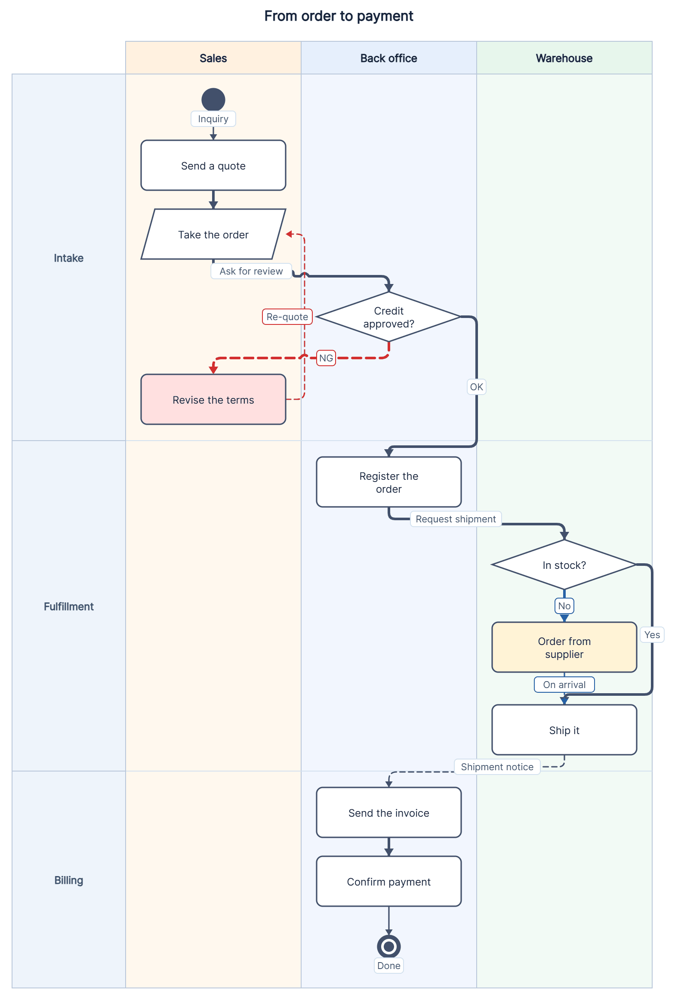

# Swimlane GUI Studio

**English** | [日本語](./README.md)

A VS Code extension for **building swimlane diagrams (cross-functional flowcharts) from forms**.
Add who does it (a lane), when it happens (a phase) and what is done, and the diagram takes shape —
no syntax to memorise. You can also load existing `.swim` code and keep editing it in the GUI.

The same tool runs in a browser at <https://tossie85.site/tools/swimlane-gui-studio.html>.
The drawing engine is [swimlane-diagram](https://github.com/Tossie85/swimlane-diagram), which also
works on its own (`npm install swimlane-diagram`).

## What it draws



Add lanes, phases, shapes and links in the forms, and this code is built alongside the diagram.
Loading the same code back gets you the GUI state again.

```
swimlane
    title "From order to payment"
    direction TB

    lane sales "Sales" #FFF1E0
    lane back "Back office" #E6EFFC
    lane ware "Warehouse" #E7F6EC

    phase p1 "Intake"
    phase p2 "Fulfillment"
    phase p3 "Billing"

    node s "Inquiry" lane=sales phase=p1 shape=startdot
    node n1 "Send a quote" lane=sales phase=p1
    node n2 "Take the order" lane=sales phase=p1 shape=io
    node d1 "Credit approved?" lane=back phase=p1 shape=decision
    node n3 "Revise the terms" lane=sales phase=p1 color=#FFE0E0
    node n4 "Register the order" lane=back phase=p2
    node d2 "In stock?" lane=ware phase=p2 shape=decision
    node n5 "Order from supplier" lane=ware phase=p2 color=#FFF3D6
    node n6 "Ship it" lane=ware phase=p2
    node n7 "Send the invoice" lane=back phase=p3
    node n8 "Confirm payment" lane=back phase=p3
    node e "Done" lane=back phase=p3 shape=enddot

    s -> n1
    n1 -> n2
    n2 -> d1 "Ask for review"
    d1 -> n4 "OK"
    d1 -> n3 "NG"
    n3 -> n2 "Re-quote"
    n4 -> d2 "Request shipment"
    d2 -> n6 "Yes"
    d2 -> n5 "No"
    n5 -> n6 "On arrival"
    n6 --> n7 "Shipment notice"
    n7 -> n8
    n8 -> e
```

Placement is given as `lane=` (who) and `phase=` (when) only — never coordinates. Routes, the hops
where lines cross and the curves where they merge are decided by the engine.

## What a swimlane diagram is

Tasks sit at the crossing of a lane (a horizontal band: who) and a phase (a vertical slice: when),
which is how a process is usually laid out in proposals, specifications and handover documents.
Mermaid has no notation for it, so this tool uses its own (`.swim`) and its own renderer
(`swimlane.js`).

## Using it

After installing, open it in any of these ways.

| Entry point | Where |
|---|---|
| Activity bar icon | The vertical strip on the left. It opens a sidebar with an "open in editor" button |
| Status bar | "Swimlane GUI" at the bottom of the window |
| Command palette | `Swimlane GUI Studio を開く` |

- Add lanes, phases, shapes and links in the forms; the preview is on the right and the `.swim`
  code is below it.
- Click a shape or an arrow in the preview and the matching item opens for editing.
- Diagrams save as **`.svg`**, **`.png`** (twice the on-screen size) or **`.html`** (a standalone
  file with the SVG embedded), and `.swim` files load back in.
- Colors have **`↩ 戻す`** (back to the previous color) and **`既定に戻す`** (drop the color).
- The **canvas** control in the header sets the background of the preview (auto / light / dark / a
  color of your choice). "Auto" follows the editor theme. It is not part of what you save.

## Pasting into Markdown

**`Markdownとしてコピー`** copies the code wrapped in a ```` ```swimlane ```` fence.

> **To see that as a diagram you also need the
> [Swimlane Diagram Preview](https://marketplace.visualstudio.com/items?itemName=tossie85.swimlane-diagram-preview)
> extension.** With it, ```` ```swimlane ```` blocks become diagrams in the built-in Markdown
> preview (`Ctrl+Shift+V`). Unlike Mermaid, `swimlane` is not a language the preview knows, so
> without the extension the block stays a code block.
>
> To use it on your own site, embed the renderer `swimlane.js` (the steps are under `ℹ️` in the
> tool, "このツールについて").

## Notable points

- **No network access** — parsing and drawing happen entirely locally (traffic is blocked by CSP).
- **Follows the theme** — the UI switches with light / dark / high contrast. The colors of the
  diagram itself stay fixed, so what you save always looks the same.
- **Round-trip notation** — attributes are named (`lane=`, `phase=`), so older files still load
  after new attributes are added.

## Development

No dependencies. Clone it and it runs.

```
npm run build     # generates the webview HTML and the engine into media/
npm test          # checks the generated files hold together as an extension (10 checks)
npm run preview   # makes a copy you can open in a browser without VS Code
```

The webview `media/index.html` is assembled from `tools/swimlane-gui-studio.html` (the same file as
the web version) and `vendor/swimlane.js`. `media/` is generated, so it is not kept in the
repository; it is rebuilt whenever the `.vsix` is packaged.

## License

[MIT](LICENSE)
