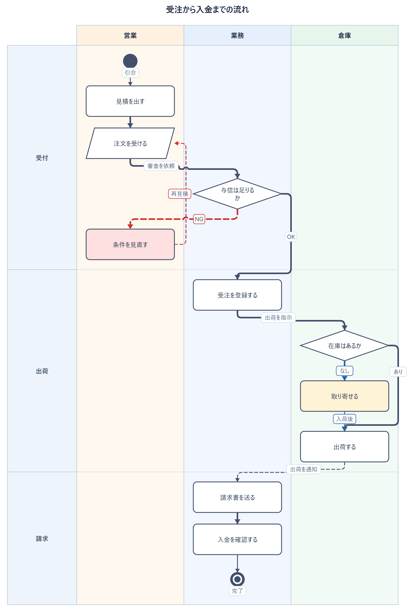

# Swimlane GUI Studio

**日本語** | [English](./README.en.md)

スイムレーン図（業務フロー図）を **GUI で組み立てられる** VS Code 拡張です。
「誰が（レーン）」「どの工程で（フェーズ）」「何をするか」を、フォームに項目を足していくだけで図にできます。
既存の `.swim` コードを読み込んで、続きを GUI で編集することもできます。

Web版（ブラウザだけで動く同じツール）は <https://tossie85.site/tools/swimlane-gui-studio.html> で公開しています。
図を描いているエンジンは [swimlane-diagram](https://github.com/Tossie85/swimlane-diagram) で、単体でも使えます。

## どんな図が描けるか



レーン・フェーズ・図形・接続をフォームで足していくと、図と一緒に次のコードができます。
逆に、このコードを読み込んで続きを GUI で編集することもできます。

```
swimlane
    title "受注から入金までの流れ"
    direction TB

    lane sales "営業" #FFF1E0
    lane back "業務" #E6EFFC
    lane ware "倉庫" #E7F6EC

    phase p1 "受付"
    phase p2 "出荷"
    phase p3 "請求"

    node s "引合" lane=sales phase=p1 shape=startdot
    node n1 "見積を出す" lane=sales phase=p1
    node n2 "注文を受ける" lane=sales phase=p1 shape=io
    node d1 "与信は足りるか" lane=back phase=p1 shape=decision
    node n3 "条件を見直す" lane=sales phase=p1 color=#FFE0E0
    node n4 "受注を登録する" lane=back phase=p2
    node d2 "在庫はあるか" lane=ware phase=p2 shape=decision
    node n5 "取り寄せる" lane=ware phase=p2 color=#FFF3D6
    node n6 "出荷する" lane=ware phase=p2
    node n7 "請求書を送る" lane=back phase=p3
    node n8 "入金を確認する" lane=back phase=p3
    node e "完了" lane=back phase=p3 shape=enddot

    s -> n1
    n1 => n2
    n2 => d1 "審査を依頼"
    d1 => n4 "OK"
    d1 ==> n3 "NG" color=#D32F2F
    n3 --> n2 "再見積" color=#D32F2F
    n4 => d2 "出荷を指示"
    d2 => n6 "あり"
    d2 ==> n5 "なし" color=#1565C0
    n5 --> n6 "入荷後" color=#1565C0
    n6 --> n7 "出荷を通知"
    n7 => n8
    n8 -> e
```

置き場所の指定は `lane=`（誰が）と `phase=`（どの工程で）だけで、座標は書きません。
線の通り道・交差のまたぎ・合流のカーブは、描画エンジン
[swimlane-diagram](https://github.com/Tossie85/swimlane-diagram) が決めます。

## スイムレーン図とは

レーン（横帯＝担当）とフェーズ（縦の区切り＝工程）の交点にタスクを置いて、業務の流れを整理する図です。
稟議書・要件定義書・引き継ぎ資料などで使われます。Mermaid には対応する記法が無いため、
このツール専用の記法（`.swim`）とレンダラー（`swimlane.js`）で描画しています。

## 使い方

インストール後、次のいずれかで開きます。

| 入口 | 場所 |
|---|---|
| アクティビティバーのアイコン | 左端の縦並び。押すとサイドバーが開き「エディタで開く」ボタンが出る |
| ステータスバー | 画面下部の「Swimlane GUI」 |
| コマンドパレット | `Swimlane GUI Studio を開く` |

- レーン・フェーズ・図形・接続をフォームで足していくと、右にプレビュー、下に `.swim` コードが出ます。
- プレビュー上の図形や矢印をクリックすると、その項目が編集状態になります。
- 図は **`.svg`** / **`.png`**（画面の2倍の大きさ）/ **`.html`**（単独で開ける埋め込みSVG）
  として保存でき、**`.swim`** ファイルからコードを読み込めます。
- 色の指定には **`↩ 戻す`**（ひとつ前の色に戻す）と **`既定に戻す`**（色の指定をやめる）があります。
- ヘッダーの **キャンバス** でプレビューの地の色を選べます（自動 / 明るい / 暗い / 任意の色）。
  「自動」はエディタのテーマに追従します。この設定は保存物には含まれません。

## Markdown に貼り付ける

**`Markdownとしてコピー`** を押すと、コードを ```` ```swimlane ```` で囲んだ形でコピーします。

> **この形で図として表示するには、拡張機能「[Swimlane Diagram Preview](https://marketplace.visualstudio.com/items?itemName=tossie85.swimlane-diagram-preview)」が必要です。**
> これを入れると、VS Code 標準の Markdown プレビュー（`Ctrl+Shift+V`）で ```` ```swimlane ```` ブロックが図になります。
> Mermaid と違い `swimlane` は Markdown プレビューが標準で知らない言語名なので、
> 入れていないとコードブロックのまま表示されます。
>
> 自分のサイトの Markdown で使いたい場合は、レンダラー `swimlane.js` を組み込みます
> （手順はツール内の `ℹ️`「このツールについて」にあります）。

## 特徴

- **外部通信なし** — 解析も描画もすべてローカルで完結します（CSP で通信を遮断）。
- **テーマ追従** — UI の配色はライト / ダーク / ハイコントラストに合わせて切り替わります。
  図そのものの配色は、保存物の見た目が変わらないよう固定にしています。
- **往復できる記法** — `lane=` `phase=` のような名前付き属性なので、項目が増えても古いファイルをそのまま読み込めます。

## 開発

依存パッケージはありません。クローンすればそのまま動きます。

```
npm run build     # media/ に Webview 用の HTML とエンジンを生成する
npm test          # 生成物が拡張として成立しているかを10件の観点で検める
npm run preview   # VS Code なしでブラウザから見られるコピーを作る
```

Web版と同じ `tools/swimlane-gui-studio.html` と `vendor/swimlane.js` から、
Webview 用の `media/index.html` を組み立てています。`media/` は生成物なので
リポジトリには持たず、`.vsix` を作るときに毎回作り直します。

## ライセンス

[MIT](LICENSE)
